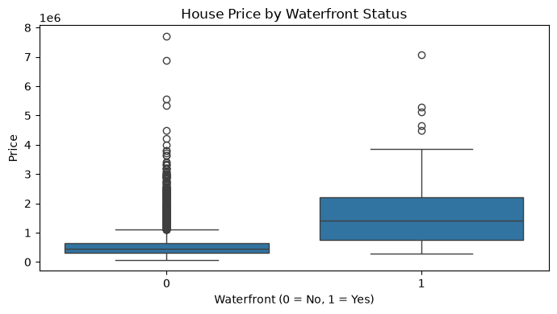
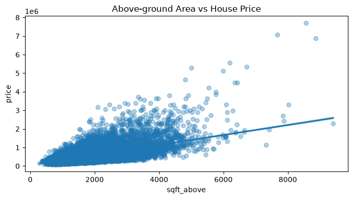

# CISC7204 Assignment 01 - Tourism Proposal and House Sales Analysis

**Author:** WANG DI  
**Student ID:** mc663385  
**Course:** CISC7204 - Data Science  
**GitHub:** [dee663385](https://github.com/dee663385)

Portfolio showcase:

https://dee663385.github.io/data-science-portfolio/assignments/assignment-01/

---

## Overview

This showcase folder presents the final Assignment 01 work in two clearly separated parts:

1. **Preliminary pair project proposal** - a data-driven study of the drivers of tourism revenue in Macao.
2. **Completed module final project** - a housing-price analysis for King County, USA, using exploratory data analysis and regularised regression.

Practice notebooks are intentionally excluded. Only the final submissions and the data needed to understand or reproduce them are included.

---

## Part 1 - Preliminary project proposal

### Project title

**Analyzing the Drivers of Tourism Revenue in Macao: An Empirical Study Based on Visitor Volume and Spending Behavior**

### Research question

> In Macao's tourism market from 2019 to 2025, is total tourism spending driven primarily by visitor volume or by visitors' spending willingness, and to what extent does hotel occupancy rate explain fluctuations in total spending?

### My contribution

WANG DI contributed to:

- data collection and alignment;
- data cleaning;
- exploratory data analysis and visualisation;
- the visual justification for the research question.

The project was prepared with partner ZhaoWei. The partner's student ID is withheld from this public version. The original Word submission remains in the private course workspace.

### Proposed data sources

- [Visitor arrivals](https://data.gov.mo/Detail?id=3546225a-2a34-4645-b01e-6752aed03993)
- [Per-capita visitor spending](https://data.gov.mo/Detail?id=f02b334a-cc44-4433-b942-672de0fdad13)
- [Total visitor spending](https://data.gov.mo/Detail?id=6466a42d-cd30-40a3-9017-3e0066e6b077)
- [Hotel occupancy rate](https://data.gov.mo/Detail?id=8812ecc5-e9ab-4e2f-b971-d3c16e46bd32)

### Proposal document

- [Read the sanitised Markdown version](proposal/preliminary-proposal.md)
- Data files: [`proposal/data/`](proposal/data/)

The proposal defines the research design and planned analysis. It does not claim completed regression results.

---

## Part 2 - House sales in King County, USA

### Research task

Predict residential house prices from property characteristics and compare how explanatory power changes as the model becomes more flexible.

### Dataset

- **Rows:** 21,613
- **Columns:** 22
- **Local file:** [`data/housing.csv`](data/housing.csv)
- **Source:** IBM Skills Network course dataset used for the CISC7204 module activity
- **Permission:** Educational coursework use

### Methods

- data import and quality inspection;
- descriptive statistics and exploratory plots;
- simple linear regression;
- multiple linear regression;
- standardisation and polynomial feature pipeline;
- train/test split;
- Ridge regression;
- second-order polynomial Ridge regression.

### Results

| Model | R-squared | Evaluation scope |
|---|---:|---|
| Price ~ longitude | 0.000468 | Full dataset |
| Price ~ `sqft_living` | 0.492853 | Full dataset |
| Multiple linear regression | 0.657695 | Full dataset |
| Scaled polynomial pipeline | 0.751341 | Full dataset |
| Ridge regression, alpha = 0.1 | 0.647876 | Held-out test set |
| Polynomial Ridge, degree = 2, alpha = 0.1 | 0.700274 | Held-out test set |

The first four scores are in-sample and are therefore not directly comparable with the two held-out test scores, which provide the more credible estimate of generalisation.

### Visual evidence





### Key findings

- Waterfront homes show more and larger high-price outliers.
- `sqft_above` has a positive correlation with price (`r = 0.6056`).
- More informative features substantially improve explanatory power over longitude alone.
- Regularisation and polynomial features improve held-out performance in this exercise.
- High in-sample R-squared values should not be interpreted as evidence of causal relationships.

Full notes: [`docs/key-findings.md`](docs/key-findings.md)

---

## Showcase structure

```text
assignment-01/
├── README.md
├── index.md
├── requirements.txt
├── proposal/
│   ├── preliminary-proposal.md
│   └── data/
├── notebooks/
│   └── house-sales-analysis.ipynb
├── data/
│   └── housing.csv
├── figures/
├── docs/
│   └── key-findings.md
└── .gitignore
```

## Reproduce the housing analysis

```bash
git clone https://github.com/dee663385/data-science-portfolio.git
cd data-science-portfolio/assignment-work/assignment-01
python -m venv .venv
pip install -r requirements.txt
jupyter notebook notebooks/house-sales-analysis.ipynb
```

## Attribution

The housing activity was completed from a course-provided IBM Skills Network notebook template. The analysis answers, modifications, and reported results are WANG DI's submission. The Macao tourism proposal was pair work with ZhaoWei; individual responsibilities are stated above.

## Related links

- [Portfolio home](https://dee663385.github.io/data-science-portfolio/)
- [Assignment 01 portfolio page](https://dee663385.github.io/data-science-portfolio/assignments/assignment-01/)