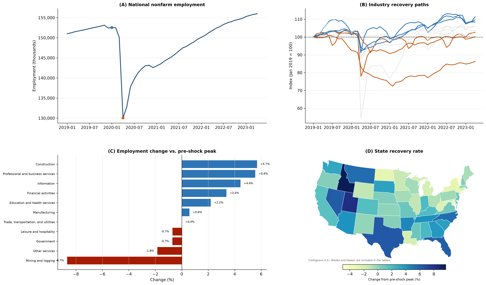
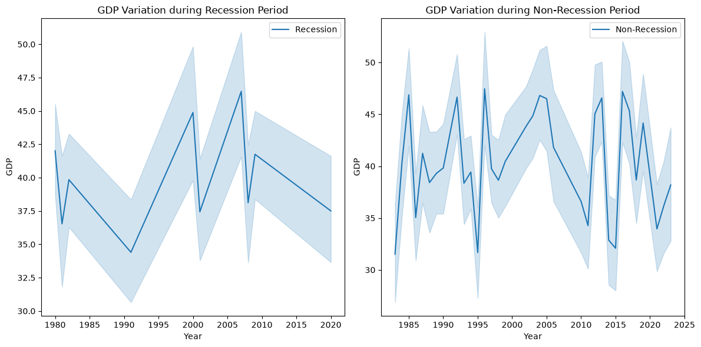
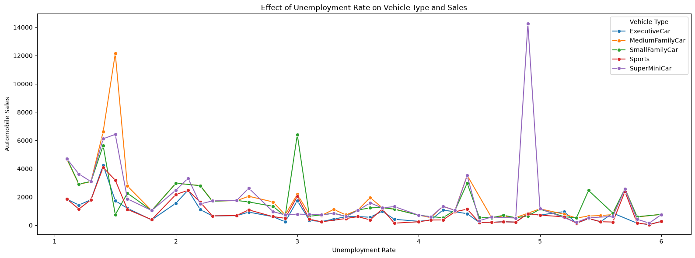
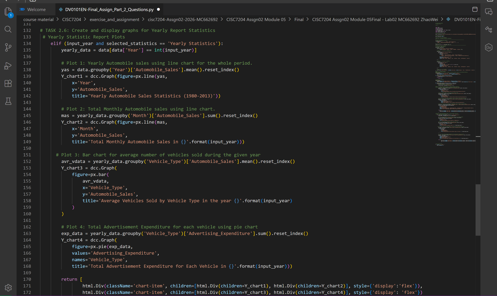

# CISC7204 Assignment 02 - Visualisation, Dashboard, and Employment Recovery

**Author:** WANG DI  
**Student ID:** mc663385  
**Course:** CISC7204 - Data Science  
**GitHub:** [dee663385](https://github.com/dee663385)

Portfolio showcase:

https://dee663385.github.io/data-science-portfolio/assignments/assignment-02/

---

## Overview

This showcase folder brings together the final Assignment 02 work in three parts:

1. **Lab 01 - individual visualisation analysis** of automobile sales, recession periods, consumer confidence, advertising expenditure, and unemployment.
2. **Lab 02 - interactive Dash dashboard** for exploring yearly and recession-period automobile statistics.
3. **Pair 04 revised project and analysis** of the uneven recovery in U.S. nonfarm employment from 2019 to 2023.

Practice notebooks and intermediate drafts are excluded. The public repository contains final work, supporting data, and reproducible outputs.

---

## Featured project - U.S. nonfarm employment recovery

### Research question

> How did U.S. nonfarm payroll employment change across major industries and states between January 2019 and April 2023, and which industries and states recovered most strongly after the COVID-19 employment shock?

### Data

- BLS Current Employment Statistics: national and industry payroll employment
- BLS State and Area Employment: state-level payroll employment
- FRED `PAYEMS`: independent check of the national total
- Coverage: 12 national series and 51 state-level series
- Analysis period: January 2019 to April 2023

### Data quality

The analysis includes automated checks for:

- complete coverage of national and state series;
- duplicate observations;
- non-positive employment values;
- availability of the January 2019 baseline;
- consistency between sector sums and the FRED national total.

All checks passed. The maximum difference between the sum of national sectors and the FRED total was **2.068%**.

### Main findings

- National nonfarm employment fell **14.7%** from its January 2020 peak to the April 2020 trough.
- By April 2023, employment was **2.2% above** the pre-shock peak.
- Strongest industry recoveries: Construction (**+5.7%**), Professional and business services (**+5.6%**), and Information (**+4.4%**).
- Weakest sectors: Mining and logging (**-8.7%**), Other services (**-1.8%**), and Government (**-0.7%**).
- Strongest state recoveries: Idaho, Utah, Texas, Nevada, and Florida.
- Weakest state recoveries: Hawaii, Vermont, District of Columbia, Rhode Island, and New York.



The analysis is descriptive. Payroll employment counts jobs rather than individual workers, the series are seasonally adjusted and subject to revision, and the results do not identify causal policy effects.

- [Analysis notebook](project/analysis.ipynb)
- [Revised proposal](project/revised-proposal.md)
- [Interactive state map](project/results/state_recovery_map.html)

---

## Lab 01 - Automobile sales visualisation

The final notebook answers twelve visual-analysis tasks using pandas, Matplotlib, Seaborn, and Folium, including:

- yearly sales trends;
- advertising expenditure versus sales;
- vehicle-type comparisons during recessions;
- GDP line plots for recession and non-recession periods;
- seasonality and consumer-confidence relationships;
- advertising-share pie charts;
- unemployment-rate effects;
- an optional choropleth map.





- [Lab 01 notebook](labs/lab-01-visualisation/automobile-sales-visualisation.ipynb)
- [Lab 01 notes and figure index](labs/lab-01-visualisation/README.md)

---

## Lab 02 - Interactive Dash dashboard

The dashboard provides:

- a report-type selector;
- a year selector for yearly statistics;
- a conditional callback that disables the year selector for recession reports;
- four interactive charts for each report mode;
- coordinated Plotly visualisations for sales, vehicle types, advertising, and unemployment.



- [Dashboard source](labs/lab-02-dashboard/dashboard.py)
- [Screenshots](labs/lab-02-dashboard/screenshots/)

The dashboard loads the public automobile-sales dataset from its course-hosted URL, so an internet connection is required.

---

## Showcase structure

```text
assignment-02/
├── README.md
├── index.md
├── requirements.txt
├── project/
│   ├── revised-proposal.md
│   ├── analysis.ipynb
│   ├── data/
│   └── results/
├── labs/
│   ├── lab-01-visualisation/
│   │   ├── automobile-sales-visualisation.ipynb
│   │   ├── README.md
│   │   └── figures/
│   └── lab-02-dashboard/
│       ├── dashboard.py
│       ├── README.md
│       └── screenshots/
└── .gitignore
```

## Reproduce the work

```bash
git clone https://github.com/dee663385/data-science-portfolio.git
cd data-science-portfolio/assignment-work/assignment-02
python -m venv .venv
pip install -r requirements.txt
jupyter notebook
```

Run the dashboard with:

```bash
python labs/lab-02-dashboard/dashboard.py
```

Then open the local Dash address shown in the terminal.

## Attribution and limitations

- Lab 01 and Lab 02 were completed from course-provided activity templates. The submitted answers, code changes, charts, and dashboard implementation are WANG DI's work.
- The revised project and employment analysis were completed with partner Zhaowei. The partner's student ID is withheld from this public version. WANG DI's stated responsibilities included coordination, visualisation design, proposal preparation, and final interpretation.
- The analysis is descriptive and does not establish causal effects.

## Related links

- [Portfolio home](https://dee663385.github.io/data-science-portfolio/)
- [Assignment 02 portfolio page](https://dee663385.github.io/data-science-portfolio/assignments/assignment-02/)